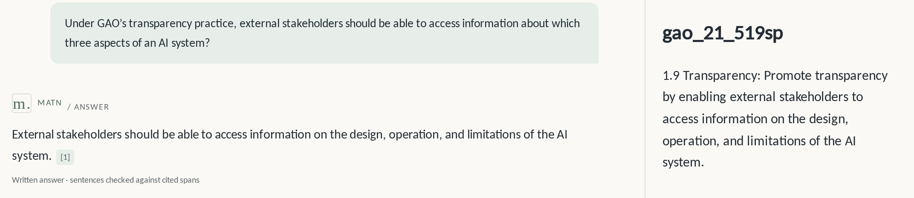
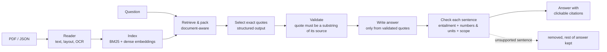
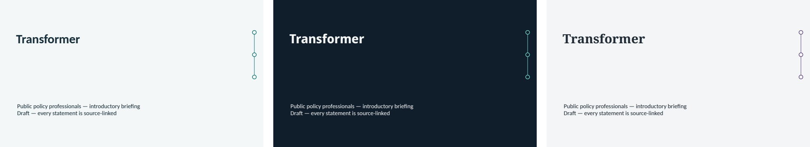
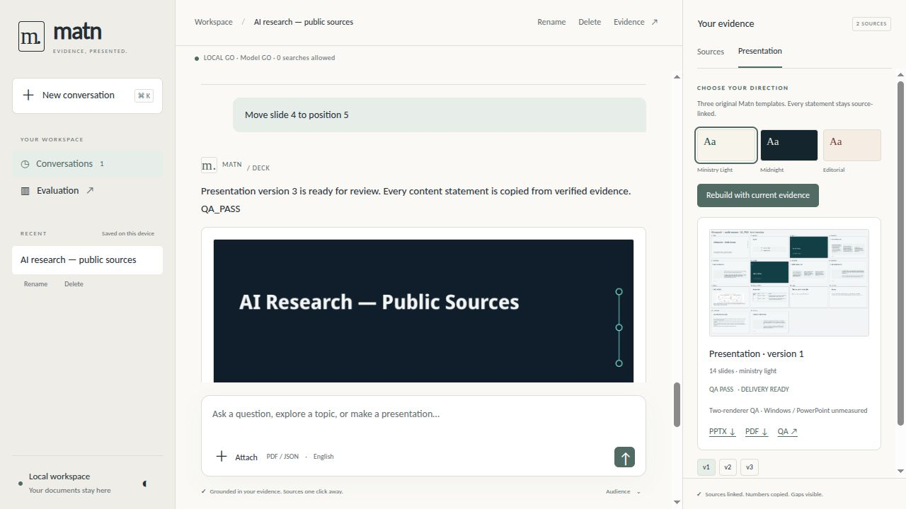
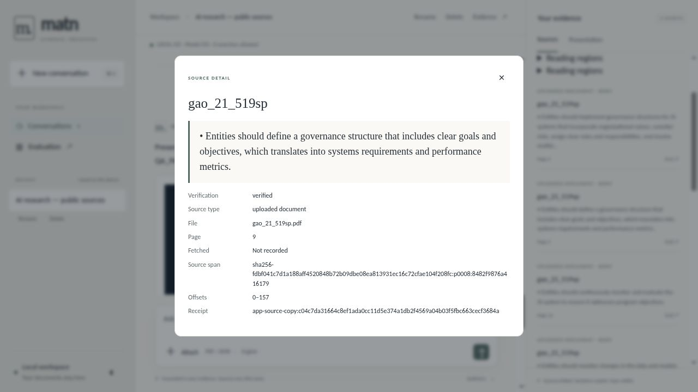

<div align="center">

# Matn

**A private, offline NotebookLM: ask your documents, and every answer leads back to the exact sentence that supports it.**

Local LLM · hybrid RAG · quote-first answers · sentence-level fact-checking · source-linked presentations

[](https://github.com/asmaasamyhagag22-design/matn-grounded-notebook/actions/workflows/offline-fast.yml)




</div>

## Why Matn

Government teams can't paste internal documents into a cloud assistant, and they can't act on an answer they can't check. Matn is built for that setting:

- **Nothing leaves the machine.** Reading, retrieval, generation and verification all run locally, on a laptop CPU with 15 GB of RAM.
- **Every sentence is traceable.** A click on a citation opens the exact source span, with its file, page and character offsets. Each verified sentence has a SHA-256 receipt.
- **It says "the sources don't answer this"** instead of filling gaps, and it never passes off retrieved text as an answer.
- **From documents to a deck.** Matn builds an editable presentation in which every statement is copied from verified evidence. You edit it by chatting.

## Results

Measured on a 4-core laptop CPU with `qwen3.5:9b` (4-bit), on questions written in advance, with answers scored blind.

| | |
|---|---|
| **3.1×** more fully correct answers than the previous version, with no increase in wrong ones | paired benchmark, 104 questions |
| **0 of 30** wrong or unsupported answers shown | sealed holdout, written by a separate model and run once |
| **176 / 176** planted errors caught, **81 / 81** true statements kept | fact-checking challenge set (wrong numbers, units, entities, years, negations, scope) |
| **~2× faster** per answer when the quote-first path replaced the original verification pipeline | earlier paired benchmark, same questions and machine |
| **×2.1** throughput from profiling the CPU pipeline | same workload, 2765 s → 1323 s |

Full methodology and per-set numbers: [docs/results.md](docs/results.md).

## How it works



**1. Read.** PDFs and JSON are parsed into blocks with page and layout information. Scanned pages go through local OCR (PP-OCRv5 via RapidOCR, with GLM-OCR as a second reader).

**2. Retrieve.** Hybrid search combines BM25 and `qwen3-embedding:0.6b` over chunks that carry their section context. When a question names a document ("According to GAO's report…"), that document is ranked first and the prompt is packed with passages from across it, under a fixed token budget.

**3. Quote first, then write.** The model first selects exact quotes from the retrieved passages; code accepts only quotes that appear verbatim in their source. The answer is then written from those quotes alone, so a citation can never point to text the model invented.

**4. Check every sentence.** Each sentence is scored by an entailment model (MiniCheck, RoBERTa-Large) against its cited quote. Deterministic checks then confirm that every number appears in the quote with the same unit or date, and that the scope (which organization, which system) has not been swapped. A sentence that fails is removed on its own; the rest of the answer stays.

## Engineering decisions

- **Fix the input, not the output.** An earlier design stacked many blocking filters after generation. Measurement showed it rejected even sentences copied verbatim from the source. Replacing it with quote-first generation and one strong sentence-level check took verbatim acceptance from 0/81 to 81/81 and roughly halved answer time; the next round of input fixes tripled fully correct answers. *(ADRs in [docs/adr](docs/adr))*
- **Retract sentences, not answers.** One unsupported sentence no longer silences a correct answer.
- **Each v3.1 change behind a switch.** Document ranking, packing, quote expansion, the writer and the added checks each have a flag in a policy file, so each change was measured alone and kept only if it helped. Three candidate features were dropped this way.
- **Evaluation you can't fool yourself with.** Sealed holdout sets are hashed before the code is written and opened once. Answers are labelled blind to the variant. A challenge set of planted errors guards against a checker that is too lenient, and verbatim controls guard against one that is too strict.
- **Fits in 15 GB.** The 6.4 GB generator and the verifier are sequenced so they are never resident together, and a memory check can defer inference when free RAM is low.
- **No hardcoded values.** Models, caps, thresholds and feature switches live in validated config files; each run records the config it used.

## Presentations

Ask for a presentation and Matn turns the verified evidence into an editable deck. Every content statement is copied from a cited source span. Edits happen in chat ("move slide 4 to position 5", "switch to the midnight template") in about 5.5 seconds, and every version can be restored.



Each deck is rendered and checked by two renderers (python-pptx geometry and a LibreOffice PDF), then exported as PPTX or PDF.

<table>
<tr>
<td width="50%"></td>
<td width="50%"></td>
</tr>
<tr>
<td align="center"><sub>Chat-edited deck with versions</sub></td>
<td align="center"><sub>Every claim opens its exact source</sub></td>
</tr>
</table>

## Tech stack

| Layer | Choice |
|---|---|
| Generation | `qwen3.5:9b` (Q4_K_M) via Ollama, structured outputs |
| Retrieval | BM25 + `qwen3-embedding:0.6b`, SQLite store |
| Verification | MiniCheck-RoBERTa-Large + deterministic number, unit, date and scope checks |
| Reading | PDF text and layout, PP-OCRv5 (RapidOCR), PP-DocLayout, GLM-OCR |
| Presentations | python-pptx, LibreOffice rendering, three original templates (OFL fonts, Heroicons) |
| App | Python 3.12, server-sent events, local web UI |
| Quality | pytest, offline CI with fake model adapters, pinned and licence-checked dependencies |

All models are Apache-2.0 or MIT licensed and run without a GPU.

## Quick start

```bash
python3.12 -m venv .venv
.venv/bin/python -m pip install -r requirements-app.txt
sudo apt-get install libreoffice-impress fonts-crosextra-carlito fonts-noto-core fonts-liberation

# Walk through the app with fixtures (no models needed)
.venv/bin/python -B -m matn_app --fake --search-budget 0

# Real local inference (after installing the models in docs/local-setup.md)
./app.sh --search-budget 0
```

Close heavy apps first: Matn needs about 7 GB of free RAM at its peak. See [local setup](docs/local-setup.md) for models and OCR.

## Repository layout

```
matn_reading/        PDF/JSON reading, layout, OCR
matn_rag/            chunking, BM25 + dense index, hybrid search
matn_chat/           conversation, retrieval packing, quote-first answering
matn_verification/   entailment, number/unit/date and scope checks
matn_deck/           presentation building, templates, rendering QA
matn_research/       topic → research (preview)
matn_app/            web app, answer policy and config
eval/  tests/        evaluation harness and test suite
docs/adr/            architecture decision records
```

## Roadmap

- Arabic documents end to end: RTL extraction, Arabic retrieval and verification
- GPU profile for the delivery server, with a larger-model bake-off
- Multi-user deployment: authentication, roles, on-premises package
- Head-to-head benchmark against NotebookLM on the same public documents

## Author

Built by **Asmaa Samy Hagag**, AI engineer (RAG, LLM systems, NLP).
[GitHub](https://github.com/asmaasamyhagag22-design)

Demo documents are public: GAO-21-519SP (U.S. GAO) and arXiv 2601.14525 (CC BY 4.0). See [demo credits](docs/demo-credits.md).

Licensed under the [MIT License](LICENSE). Third-party asset licences are included with each asset.
