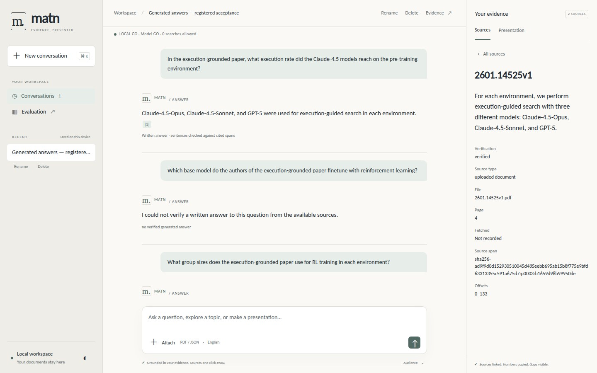
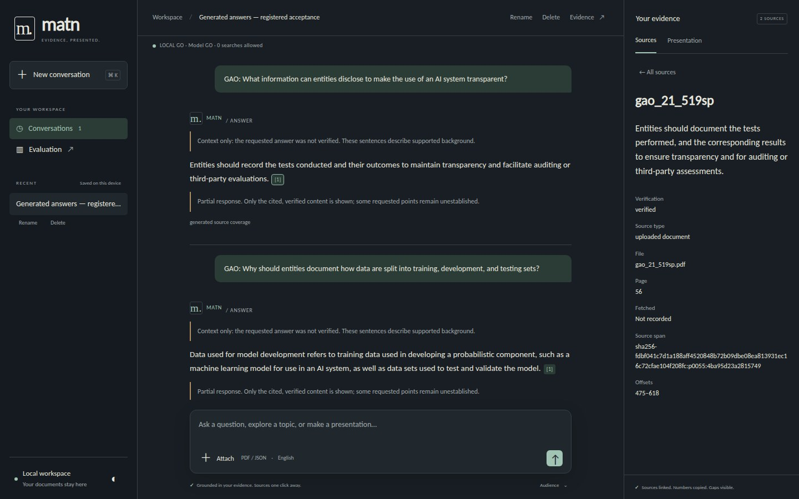
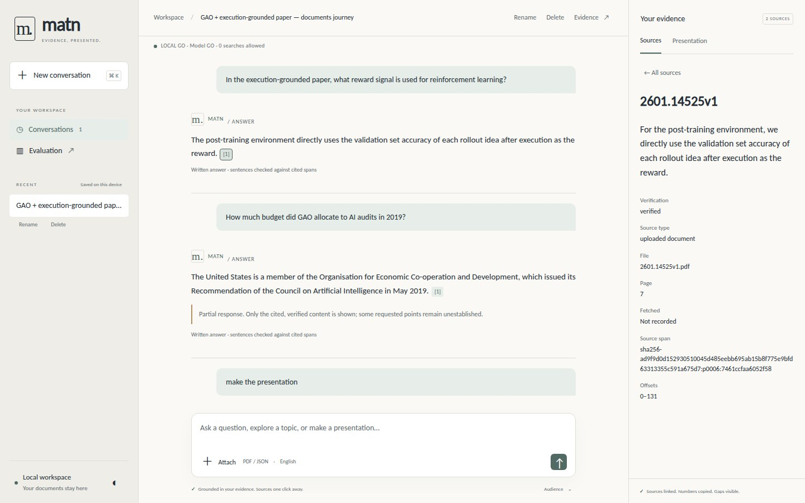

# Matn — evidence, presented

A local notebook for public documents, source-linked research and editable presentations. Matn reads PDF/JSON files, keeps exact evidence behind citations, and builds versioned decks with measured layouts.

**Current quality status: generated-answer acceptance FAIL (twice).** Memory errors are fixed, but on this CPU laptop most generated answers are still blocked by verification or arrive too slowly. Topic research is experimental. These results do not establish deployment readiness.



A real answers-v2 acceptance turn about *Towards Execution-Grounded Automated AI Research* (arXiv 2601.14525v1, CC BY 4.0). The sentence is verified against the cited span (open in the side panel), but it names the models instead of the execution rate that was asked, so the review counts it as **not a direct answer**. The next question shows the plain notice used when no sentence passes verification.



When the requested answer is not verified, Matn may still write verified context, labelled "Context only". It never shows retrieved passages as the reply. Both screenshots use only GAO-21-519SP and the CC BY paper; [demo credits](docs/demo-credits.md) identify the paper and its licence.



A later **demo** turn (not part of the acceptance set), run with the other desktop apps closed: a direct, verified answer in 155.7 s with the exact span open in the side panel. In the same conversation, "What are the four principles…?" got a verified sentence about something else, which is why acceptance still fails.

## Two journeys

**Bring documents.** Read public PDFs or JSON → overview of each source → ask questions → open the exact cited span → build a presentation → edit and restore deck versions. The chat plans source handles, writes prose, verifies every sentence (numbers, dates, entities, entailment, subject/actor) fail-closed, and allows one repair. Retrieved text is never the reply. Follow-ups are rewritten into a standalone question, shown in the trace, never in the answer.

**Explore a topic (experimental, about 10 minutes).** Clarify the subject and audience → edit a four-axis plan → explicitly allow searches → read public sources → inspect supported units and gaps → build a presentation. **The v2 improvement attempts failed pre-registered holdouts, so the shipped path is the earlier, more conservative version.** The v2 code stays behind a developer flag (`--dev-research-v2`), off by default. Search allowance starts at zero.

## Latest measured results

Questions and pass rules were registered before each run. Review is cross-family **AI review (not human gold)**; owner labels are counted separately and override AI review for their exact sentences. The portable public export differs from the measured private build; public CI does not reproduce these semantic scores.

| Measurement (4 Nov, answers v2, 20 new questions) | Result |
|---|---|
| Direct generated answers (17 answerable) | **0/17**, required 12 — FAIL |
| Verified "not covered" replies (3 unanswerable) | **0/3** — FAIL |
| Retrieved excerpts shown as answers | 0 — pass |
| AI-reviewed silent errors in displayed sentences | 0 (3 borderline) — pass |
| Median full answer | **381.4 s**, limit 300 s — FAIL |
| `chat_error` / failed turns | **2** (one model-server crash, one interrupted turn) — FAIL |
| Memory-guard deferrals (`DEFERRED_MEMORY_*`) | 0 (was 18/20 on 2 Nov) |

The 2 Nov run (0/20) also stands. Most drafts were rejected by the subject/attribution and scope checks before entailment; whether these are false blocks is pending owner labels, and no threshold was relaxed.

## CPU memory and latency limits

Measured on a 4-core CPU laptop, 15 GiB RAM, no GPU, with `qwen3.5:9b` (Q4_K_M, about 6.4 GiB resident) and a separate 1.6 GiB entailment verifier. The two never stay resident together; the generator is unloaded between calls only when free memory would fall below the 1.5 GiB guard. Matn needs about 7 GiB at its peak. With other desktop apps holding 8–11 GiB, the kernel ran out of memory and killed the model process during measurement. Close heavy browser tabs and other AI apps before asking questions. A typical answer takes 2–7 minutes (about 10 prompt tokens/s); a question that ends without a verified answer runs the planner twice and takes longer.

## Review and presentations

- Local owner review at `/labels/`, linked from Evaluation: exact context, Correct/Wrong/Borderline/Skip and notes. AI judgments stay hidden until a decision. Evaluation shows "owner-labelled n / AI-only m" for each verdict, and `scripts/recompute_verdicts.py` recomputes every verdict from owner labels.
- Generated sentences have small citation links; the exact source text appears in the side panel after a click.
- Layout checks inspect geometry and the LibreOffice PDF. They do not establish evidence quality or Windows PowerPoint fidelity.

## Run locally

Python 3.12, LibreOffice and the fonts in `design/fonts/fonts.json` are required for presentation rendering. Real generation, independent verification and OCR require separately provisioned local model environments. See [local setup](docs/local-setup.md).

```bash
python3.12 -m venv .venv
.venv/bin/python -m pip install -r requirements-app.txt
sudo apt-get install libreoffice-impress fonts-crosextra-carlito fonts-noto-core fonts-liberation
# Labelled fixture walkthrough; no real model or search calls:
.venv/bin/python -B -m matn_app --fake --search-budget 0
```

For real inference, provision the models described in the setup guide and run `./app.sh --search-budget 0`. Local preflight is not a provider quota check. Research requires separate explicit search allowance. Use public documents only.

## Validation and remaining work

The offline CI subset runs in a clean environment with synthetic sources and fake adapters. [Export validation](docs/export-validation.md) records the checks; private measurements are not bundled. Historical results are [kept separately](docs/results.md).

Remaining work: directly responsive answers (most drafts are still blocked or off-target), an owner-measured false-block rate for the attribution and scope checks, answer latency under 5 minutes on CPU, safe coexistence with other desktop apps in 15 GiB, semantic agreement detection between sources, broader human labels and Windows PowerPoint validation. Measured failures remain visible.

Created by Asmaa Samy Hagag with AI-assisted implementation, testing and review. Project licence selection is pending; third-party asset licences are included with the relevant assets.
