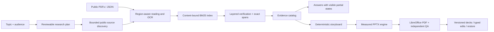
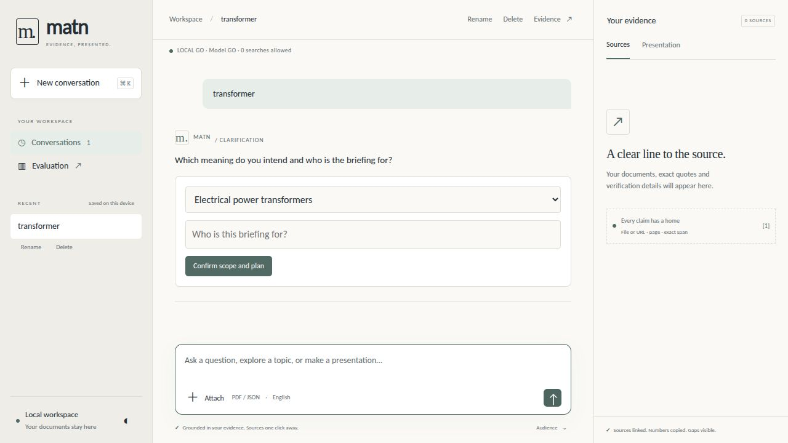

# Matn — evidence, presented

A local document notebook that turns public PDFs and structured files into source-linked briefings and editable presentations. Open the exact page and span behind a claim, inspect what remains unestablished, and restore an earlier deck without rewriting its evidence.


These are real local runs using GAO-21-519SP and *Towards Execution-Grounded Automated AI Research* (arXiv 2601.14525v1). The second document is CC BY 4.0; [demo credits](docs/demo-credits.md) identify its authors, version, licence and source. No World Bank document content is distributed. Screenshots show the application and selected source excerpts, with no endorsement implied.

Long documents create two connected problems: finding useful evidence and presenting it without detaching claims from their sources. Matn keeps an evidence catalog between reading, answering and rendering. Models select or propose within bounded schemas; code binds source IDs, preserves qualifiers, verifies statements and copies numeric values.

## Two journeys

**Bring documents.** Upload public PDF/JSON files → inspect verified source overviews → ask a question → open its cited span → build a presentation → type a supported edit → restore a version. Early reading checkpoints make completed pages queryable; duplicate documents reuse content-bound preparation.

**Explore a topic.** Clarify meaning and audience → review a populated research plan → explicitly allocate searches → read public sources → inspect verified units, gaps and source balance → build the same evidence-bound presentation. Search starts at zero allowance. Commercial majorities receive a warning; unsupported axes remain gaps.





The clarification screenshot is a separate real scope check with zero searches; it is not a fresh-topic evaluation result.

## Engineering choices

- Fail-closed sentence verification and copied numeric values; a valid schema alone never establishes factual support or edit intent.
- Region labels keep footnotes, references and navigation fragments out of ordinary evidence selection.
- A content- and implementation-bound cache, resumable page checkpoints, foreground model ownership and bounded prompts address measured CPU bottlenecks.
- Layouts follow evidence types: grouped findings, comparisons, disagreements, qualified key numbers, source figures, dated units, section dividers and source-linked closing slides.
- Three original Matn templates, pinned OFL font manifests and MIT Heroicons; citations remain readable and source detail stays in notes.
- Two renderer QA checks measured text geometry and the actual LibreOffice PDF. Failing decks remain reviewable failures rather than successful downloads.
- Pre-registered targets and fresh-topic acceptance criteria are frozen before measurement. Runtime identities bind source, configuration and assets. AI review is labelled separately from human judgment.

## Measured results

Four pre-registered fresh research topics: **FAIL**, with cross-family AI review of every displayed unit (not human gold). 18 displayed units, 6 confirmed silent errors and 7 retained borderline units; all four result pages were preserved. The unchanged six-condition acceptance rule failed. Search spending was 48/48, using a separate evaluation ledger. No candidate changes followed these outcomes.

On the 12-question document development set: **6 answered / 4 partial / 2 refused**, zero AI-reviewed silent errors; zero clear false blocks in the final reviewed sample of one rejected borderline candidate. This small sample is not a general verifier accuracy estimate.

On the same CPU and fixed inputs, the profiled upload-and-question workload fell from **2765s to 1323s (52%)**. GAO upload680s met its 900s target; the 45-page economic-report upload390s missed 360s. Full answers278s/251s met 300s; first persisted source-bound answers278s/251s missed 240s. Queue wait0.021s met 1s. Duplicate uploads7–8s met 20s with no new extraction/OCR/embedding/generation/verification calls. These are M2 measurements; later real-demo timings and limitations are [recorded separately](docs/results.md).

All 22 synthetic evidence/layout slides passed both renderers in each of the three original templates. Six rebuilt saved decks also passed. This is local layout verification, not Windows PowerPoint validation or evidence-quality acceptance.

The 12-question document set is a development set, not a holdout. “Answered” describes the reviewed response state; the current app primarily returns complete verified source copies, and free-form synthesis remains limited. The public demonstration itself had one answered and one partial response. Rejected attempts and regressions are retained in the evaluation records.

## Run locally

Python 3.12, LibreOffice and the fonts listed in `design/fonts/fonts.json` are required for presentation rendering. Local generation, independent verification and OCR require separately provisioned, pinned model environments; model weights and documents are not bundled.

```bash
python3.12 -m venv .venv
.venv/bin/python -m pip install -r requirements-app.txt
# Ubuntu rendering dependencies:
sudo apt-get install libreoffice-impress fonts-crosextra-carlito fonts-noto-core fonts-liberation
# Clearly labelled UI walkthrough; no real model or search calls:
.venv/bin/python -B -m matn_app --fake --search-budget 0
```

For real local inference, follow [local setup](docs/local-setup.md), then run `./app.sh --search-budget 0`. The local preflight is not a provider quota check. Research requires a separate, explicit search allowance. Use public documents; this repository contains no ministry material.

## Validation and limits

The workflow runs an offline fast subset in a clean environment. It verifies structural contracts and deterministic behaviour without downloading models or reproducing the private document/holdout evaluations. The exact command and local clean-environment result are [recorded with the export](docs/export-validation.md).

CPU latency remains measured in minutes for larger PDFs. Source-copy answers can be useful and responsive while still leaving parts unestablished. Vendor coverage and axis selection remain imperfect. Cross-family AI review is not human gold. Windows PowerPoint rendering is unmeasured; local QA uses the measured engine and LibreOffice. A passing layout check does not establish the truth or completeness of its source material.

## Roadmap

Improve directly responsive, source-bound synthesis; reduce false blocks without relaxing evidence requirements; broaden independent human evaluation; improve noncommercial source coverage; and validate the editable output in Windows PowerPoint.

Created by Asmaa Samy Hagag with AI-assisted implementation, testing and review. Project licence selection is pending; third-party asset licences are included with the relevant assets.
