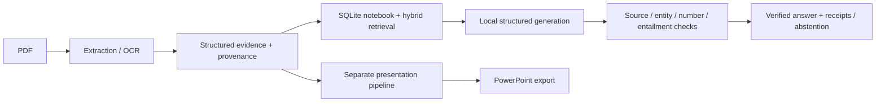

# Matn | Evidence-Grounded Document Intelligence

**Built by [Asmaa Samy Hagag](https://github.com/asmaasamyhagag22-design)**

Matn is a local document AI project for turning PDFs into traceable evidence, searchable notebooks, grounded answers, and PowerPoint presentations. The engineering focus is on **source provenance, numerical fidelity, reproducible evaluation, and reliable operation on limited hardware**.

**Status:** an actively developed research and engineering prototype. PDF reading, retrieval, verification, chat, and presentation rendering are implemented as separate components. The chat API/CLI is experimental and is not yet integrated into the presentation dashboard.

## What the project demonstrates

- **Document processing:** page-preserving extraction, structured blocks, stable IDs, bounding boxes, section boundaries, and explicit handling of unavailable table values.
- **OCR reliability:** isolated OCR workers and independent checks for numerical content; disagreement is retained for review rather than silently accepted.
- **Local RAG:** SQLite-backed notebooks, source-scoped BM25 and vector retrieval, cached embeddings, and deterministic rank fusion. The selected configuration uses retrieval without a reranker.
- **Grounded generation:** structured JSON responses cite code-owned sentence handles. Code maps those handles to exact source spans instead of asking the model to invent offsets.
- **Verification:** ordered checks cover source validity, lexical support, entity/scope mismatches, numerical fidelity, and local entailment. Only sentences that pass are displayed, with verification receipts; insufficient evidence produces an abstention.
- **Systems engineering:** digest-pinned models, resumable checkpoints, input/code hashes, explicit context budgets, memory guards, and process isolation.
- **Presentations:** reusable PowerPoint templates, source-linked facts, layout checks, and export tooling.

## Architecture



## Where to review the engineering

| Component | Entry points |
|---|---|
| Reading and document contracts | [`matn_reading/`](matn_reading/), [`matn_contracts/`](matn_contracts/) |
| Retrieval and notebook storage | [`matn_rag/search.py`](matn_rag/search.py), [`matn_rag/sqlite.py`](matn_rag/sqlite.py) |
| Sentence handles and buffered chat | [`matn_chat/handles.py`](matn_chat/handles.py), [`matn_chat/engine.py`](matn_chat/engine.py) |
| Verification rules and model adapter | [`matn_verification/rules.py`](matn_verification/rules.py), [`matn_verification/l4.py`](matn_verification/l4.py) |
| Presentation rendering | [`matn_presentation/`](matn_presentation/), [`matn_deck/`](matn_deck/) |
| Regression tests | [`tests/chat/`](tests/chat/), [`tests/verification/`](tests/verification/), [`tests/rag/`](tests/rag/) |

## Run the deterministic component tests

Development currently uses Ubuntu and Python 3.12. Earlier Windows setup and OCR dependencies are documented separately in [`docs/ocr_setup.md`](docs/ocr_setup.md).

```bash
git clone https://github.com/asmaasamyhagag22-design/matn-grounded-notebook.git
cd matn-grounded-notebook
python3.12 -m venv .venv
source .venv/bin/activate
python -m pip install -r requirements-dev.txt
python -m pytest tests/chat tests/verification tests/rag -q
```

These component tests use synthetic fixtures and mocked model responses; they do not download model weights or run live inference. The full suite also includes rendering and optional OCR integration tests, which require their documented fonts, system tools, and local assets.

For a local document, the reader entry point is:

```bash
python -m matn_reading read /path/to/public-document.pdf --out out/document
```

Scanned inputs require the separately configured OCR environment. Live chat additionally requires Ollama, the pinned generator, local verifier weights, and a populated notebook with authoritative structure sidecars. PDFs, model weights, private evaluation inputs, and generated runs are not bundled. See the CLI contract with `python -m matn_chat --help`.

## Evidence and current limitations

The 19 October public baseline passed **1,042 tests** (9 prerequisite-based skips); its corresponding private development baseline passed **1,139 tests**. This is regression coverage, not a document-understanding accuracy score. Public-checkout validation and the scope of the latest experiments are documented in [`docs/VALIDATION.md`](docs/VALIDATION.md).

An earlier chat collection was limited by a 15 GiB CPU laptop: 22 of 60 questions reached generation, including two partial attempts; 40 questions and all 39 confirmation questions were deferred by the memory guard. Two answers passed the verifier. Those generation and verification counts do not establish answer accuracy or production readiness.

A subsequent CPU runtime diagnostic added an opt-in Linux launcher that bounds host prompt-cache memory to 512 MiB. In eight matched requests per configuration on fresh public RFC inputs, sampled peak runner RSS fell from 7.91 to 7.68 GiB, with no OOM or runner recycling; total request latency rose 84.9%, mostly on revisiting evicted prompts. This is short-run evidence, not a long-run stability guarantee. See [CPU runtime setup and measurements](docs/cpu-runtime.md).

Arabic rendering, heterogeneous scans, high abstention rates, CPU latency, and end-to-end integration remain active limitations. This project documents failed experiments and resource limits alongside successful tests.

## Publication and dependencies

This repository contains the public engineering copy. Sealed evaluation gold, internal coordination records, source PDFs, model weights, and local outputs are excluded. Model-produced evaluation labels retain their provenance and are not presented as human gold. See [`docs/PUBLICATION_NOTES.md`](docs/PUBLICATION_NOTES.md).

Dependencies retain their own licenses. Licensing boundaries and delivery considerations are tracked in [`docs/adr/`](docs/adr/) and [`ENGINEERING_RULES.md`](ENGINEERING_RULES.md).
