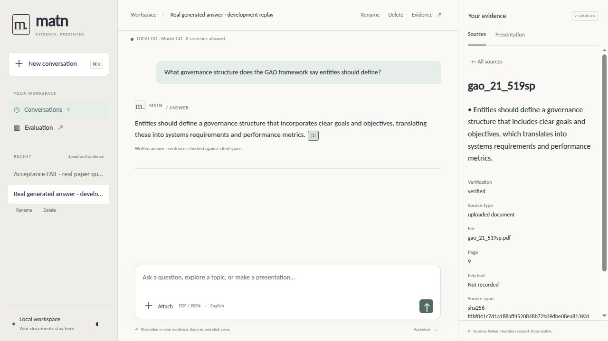
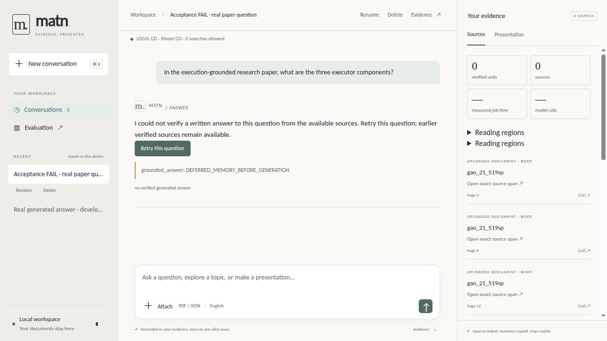

# Matn — evidence, presented

A local notebook for public documents, source-linked research and editable presentations. Matn reads PDF/JSON files, keeps exact evidence behind citations, and builds versioned decks with measured layouts.

**Current quality status: generated chat acceptance FAIL; research v2 acceptance FAIL.** The implementation is available for inspection and development. These results do not establish deployment readiness or improved research accuracy.



This is a saved real **development** answer about GAO-21-519SP, rendered without a new model call. It is a short verified paraphrase, not one of the 20 acceptance results. A citation opens the exact source span in the side panel; retrieved passages are excluded from the chat reply path.



This real acceptance attempt returned an operational inability notice after a memory guard deferred generation. It **does not count as an answer**. Both screenshots use only GAO and *Towards Execution-Grounded Automated AI Research* (arXiv 2601.14525v1, CC BY 4.0). [Demo credits](docs/demo-credits.md) identify the paper and its licence. No World Bank content, private review data, model weights or evaluation documents are distributed.

## Two journeys

**Bring documents.** Read public PDFs or JSON → ask a question → inspect its exact cited span → build a presentation → edit and restore deck versions. The current chat path retrieves internally, plans source handles, generates prose, verifies each sentence, and permits one repair. Source-copy and excerpt recovery are excluded from chat replies. Unsupported or operationally blocked attempts can still fail to produce verified prose; the acceptance result below measures that limitation.

**Explore a topic.** Clarify the subject and audience → edit a four-axis plan → explicitly allocate searches → read public sources → inspect supported units and gaps → build a presentation. Search allowance starts at zero. The live UI defaults to the historical delivery baseline; the failed v2 candidate is separately selectable for development.

## Latest measured results

The runtime and questions were registered before measurement. Review is cross-family **AI review, pending owner labels**, not human gold. The portable public export differs from the measured private build; public CI does not reproduce these semantic scores.

| Measurement | Result |
|---|---|
| Generated-answer acceptance, 20 new questions | **FAIL: 0/20 direct generated answers**, required 14/20. There were 19 abstentions and one failed follow-up route; 18 questions recorded `DEFERRED_MEMORY_BEFORE_GENERATION` as `chat_error`. |
| Answer latency | No full generated answer completed, so median full-answer latency is **unmeasured**. The 172.2-second median for completed notices is not an answer-latency success. |
| Source passages in chat | No retrieved excerpts counted as answers; regression checks hide saved legacy source-copy replies. |
| Verifier development diagnostic | 60 controlled paraphrases from ten used source units: rejection fell from 25/60 to 7/60 after app actor-parsing changes. This is author self-review, not independent gold or an owner-measured false-block rate. |
| Four new research holdouts | **FAIL:** 20 displayed units, 9 AI-reviewed errors and 9 retained borderline units. Mean displayed-axis coverage 3.25 missed the strict requirement >3.25. |
| New research source balance | Unweighted mean vendor share: **49.13% read / 64.58% displayed**, above the fixed 39.32% / 44.82% ceilings under the same classifier. |
| Research timing and retrieval bench | Four result pages; workflow first verified units at 225.4/200.9/207.3/251.6 seconds, within 412.175 seconds. The offline bench recovered from 17 regressions to no comparison violations. These passes do not waive failed quality gates. |
| Historical M7 research holdouts | **FAIL:** 18 displayed units, 6 AI-reviewed errors and 7 borderline. This historical result remains unchanged. |

The new research evaluation used a separate **48/48 search** allowance. Failed questions and topics were retained without tuning or rerunning them as fresh holdouts. Different topics do not establish direct superiority to delivery. Source-copy verification alone does not prove relevance or semantic completeness.

## Review and presentations

- Local owner review at `/labels/`, linked from Evaluation: exact context, Correct/Wrong/Borderline/Skip, notes and keyboard shortcuts. Decisions save locally; AI judgments remain hidden until a decision. Owner labels are counted separately.
- Generated sentences have small citation links. Exact source text appears in the source panel after a click.
- The presentation panel follows the latest edit. Selecting an older deck identifies both versions and provides a return-to-latest action.
- Layout checks inspect geometry and the LibreOffice PDF. They do not establish evidence quality or Windows PowerPoint fidelity.

## Run locally

Python 3.12, LibreOffice and the fonts in `design/fonts/fonts.json` are required for presentation rendering. Real generation, independent verification and OCR require separately provisioned local model environments. See [local setup](docs/local-setup.md).

```bash
python3.12 -m venv .venv
.venv/bin/python -m pip install -r requirements-app.txt
sudo apt-get install libreoffice-impress fonts-crosextra-carlito fonts-noto-core fonts-liberation
# Labelled fixture walkthrough; no real model or search calls:
.venv/bin/python -B -m matn_app --fake --search-budget 0
```

For real inference, provision the models described in the setup guide and run `./app.sh --search-budget 0`. Local preflight is not a provider quota check. Research requires separate explicit search allowance. Use public documents only.

## Validation and remaining work

The offline CI subset runs in a clean environment with synthetic sources and fake adapters. [Export validation](docs/export-validation.md) records the checks; private measurements are not bundled. Historical results are [kept separately](docs/results.md).

Remaining work includes generation memory readiness, independent question routing, directly responsive answers, research-axis admission, publisher balance, broader human labels and Windows PowerPoint validation. Measured failures remain visible.

Created by Asmaa Samy Hagag with AI-assisted implementation, testing and review. Project licence selection is pending; third-party asset licences are included with the relevant assets.
